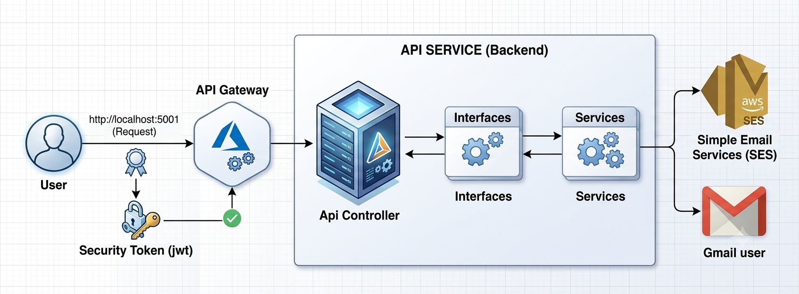

# 📬 Notification API

.NET 10 REST API that sends email notifications through **AWS SES** or **SMTP** (MailKit).

## 🗺️ Architecture



A request flows through `NotificationController` → AutoMapper (`EmailRequest` → `EmailDto`) → `NotificationService`, which sends the email through either the AWS SES client or an SMTP connection.

## 📋 Requirements

- ✅ .NET SDK 10
- ✅ For the SES endpoint: AWS credentials (AWS CLI profile or environment variables) and a sender address verified in SES
- ✅ For the SMTP endpoint: an SMTP account (host, port, user, password)
- 🐳 Docker (optional)

## 📁 Solution structure

```text
NotificationApi.sln
├── NotificationApi.csproj          # API host
├── NotificationApi.Tests/          # xUnit + Moq unit tests
├── Controllers/                    # Notification endpoints
├── Services/                       # SES / SMTP logic, DTOs and settings
├── Contracts/Request/              # API request models
├── Mappers/                        # AutoMapper profiles
├── Configurations/                 # Service registration helpers
├── Dockerfile
├── azure-pipelines-acr.yml         # CI/CD → Azure Container Registry
├── azure-pipelines-ecr.yml         # CI/CD → AWS ECR
├── NotificationApi.http            # Sample HTTP requests
└── appsettings.Development.json    # Local config
```

## 🚀 Run locally

```bash
dotnet restore
dotnet run --project NotificationApi.csproj
```

- HTTP: `http://localhost:5142`
- HTTPS: `https://localhost:7137`
- Swagger (Development only): `http://localhost:5142/swagger`
- Version: `GET /api/v1/Notification/version`

Sample requests are in [`NotificationApi.http`](NotificationApi.http), which you can run from VS Code (REST Client) or Visual Studio.

### 🧪 Tests

```bash
dotnet test
```

The tests cover the controller (status codes and response bodies), the AutoMapper profile, and `NotificationService`. The SES client is mocked. The SMTP tests only cover the connection-failure case, so no real email is sent.

## ⚙️ Configuration

The app reads these sections from `appsettings.json`, `appsettings.{Environment}.json`, user secrets, or environment variables. It binds `SMTPSetting` and `AWSSetting` by those exact names:

```json
{
  "Auth0App1": {
    "Issuer": "your-issuer",
    "Audience": "your-audience"
  },
  "Auth0App2": {
    "Issuer": "your-issuer",
    "Audience": "your-audience"
  },
  "SMTPSetting": {
    "Port": 587,
    "Host": "smtp-mail.outlook.com",
    "Email": "your-email@domain.com",
    "Password": "your-password",
    "Name": "Notification API"
  },
  "AWSSetting": {
    "Region": "us-west-1",
    "EmailFrom": "verified-sender@domain.com"
  }
}
```

| Key | Used for |
| --- | --- |
| `SMTPSetting:Host` / `Port` | SMTP server. The TLS mode is negotiated automatically. |
| `SMTPSetting:Email` / `Password` | SMTP login. `Email` is also the sender address. |
| `SMTPSetting:Name` | Sender display name for SMTP emails |
| `AWSSetting:EmailFrom` | Sender address for SES. It must be verified in SES. |
| `AWSSetting:Region` | Not used yet. See **AWS region and credentials**. |
| `Auth0App1` / `Auth0App2` | JWT issuer and audience for two Auth0 applications. See **Known limitations**. |

### 🔐 Secrets

Don't commit real passwords to `appsettings*.json`. For local development, use user secrets:

```bash
dotnet user-secrets init
dotnet user-secrets set "SMTPSetting:Email" "your-email@domain.com"
dotnet user-secrets set "SMTPSetting:Password" "your-password"
```

As environment variables (Docker, CI, cloud), replace `:` with a double underscore: `SMTPSetting__Password`, `AWSSetting__EmailFrom`, `Auth0App1__Issuer`, and so on.

### ☁️ AWS region and credentials

The SES client is created by the AWS SDK (`AddAWSService`). The SDK gets its credentials and region from the default AWS chain, **not** from `AWSSetting`:

- Credentials: `AWS_ACCESS_KEY_ID` / `AWS_SECRET_ACCESS_KEY`, an AWS CLI profile (`AWS_PROFILE`), or an IAM role when running in AWS.
- Region: the `AWS_REGION` environment variable, or an `"AWS": { "Region": "us-west-1" }` section in appsettings.

The IAM identity needs the `ses:SendEmail` permission.

> **SES sandbox:** new SES accounts start in sandbox mode. In sandbox mode, **both the sender and the recipient** must be verified, and sending limits are low. To send to any address, request production access in the SES console.

## 📚 Endpoints

| Method | Path | Description |
| --- | --- | --- |
| `POST` | `/api/v1/Notification/send-ses` | Send an email via AWS SES |
| `POST` | `/api/v1/Notification/send-smpt` | Send an email via SMTP (the route is spelled `send-smpt`) |
| `GET` | `/api/v1/Notification/version` | Returns `"v1.0.0"` |

### Request body (both send endpoints)

```json
{
  "recipientName": "John Doe",
  "recipientEmail": "john@example.com",
  "subject": "Welcome!",
  "body": "<h1>Hello John</h1><p>Thanks for signing up.</p>"
}
```

Both endpoints send `subject` as the email subject and `body` as **HTML**. With SMTP, the sender is `SMTPSetting:Name <SMTPSetting:Email>`. With SES, the sender is `AWSSetting:EmailFrom`. `recipientName` is used only by SMTP, as the recipient display name.

### Example

```bash
curl -X POST http://localhost:5142/api/v1/Notification/send-ses \
  -H "Content-Type: application/json" \
  -d '{"recipientName":"John Doe","recipientEmail":"john@example.com","subject":"Hi","body":"<p>Hello</p>"}'
```

### Responses

| Endpoint | Result | Status | Body |
| --- | --- | --- | --- |
| `send-ses` | Sent | `200` | `{ "message": "OK" }` |
| `send-ses` | SES error | `200` ⚠️ | `{ "message": "<error message>" }` |
| `send-smpt` | Sent | `200` | `"Email sent successfully"` |
| `send-smpt` | SMTP error | `200` ⚠️ | `"Error sending email: <error message>"` |
| any | Malformed JSON | `400` | ASP.NET validation `ProblemDetails` |

⚠️ Send failures currently return `200`, so callers must check the response body. See **Known limitations**.

## 🐳 Docker

```bash
docker build -f Dockerfile -t notification-api .

docker run -d -p 8787:80 \
  -e ASPNETCORE_ENVIRONMENT=Development \
  -e AWS_REGION=us-west-1 \
  -e AWS_ACCESS_KEY_ID=your-key-id \
  -e AWS_SECRET_ACCESS_KEY=your-secret \
  -e AWSSetting__EmailFrom=verified-sender@domain.com \
  -e SMTPSetting__Host=smtp-mail.outlook.com \
  -e SMTPSetting__Port=587 \
  -e SMTPSetting__Email=your-email@domain.com \
  -e SMTPSetting__Password=your-password \
  -e SMTPSetting__Name="Notification API" \
  --name notification-api notification-api
```

- API in the container: `http://localhost:8787` (the app listens on port 80 inside the container)
- Swagger: `http://localhost:8787/swagger`. It's only available when `ASPNETCORE_ENVIRONMENT=Development`.

## 🔄 CI/CD (Azure Pipelines)

Two pipelines build the Docker image and push it to a container registry. Both run on every push to `main` (PRs are not built), and the image is tagged with the commit SHA (`$(Build.SourceVersion)`).

| File | Registry | Required pipeline variables |
| --- | --- | --- |
| `azure-pipelines-acr.yml` | Azure Container Registry | `AZURECR_USER`, `AZURECR_PASSWORD`, `DOCKER_REPOSITORY_NAME`, `DOCKER_IMAGE` |
| `azure-pipelines-ecr.yml` | AWS Elastic Container Registry | `AWS_ACCESSKEYID`, `AWS_SECRETACCESSKEY`, `AWS_REGION`, `AWS_ACCOUNTID`, `DOCKER_REPOSITORYNAME` |

Store credentials as **secret** pipeline variables. The pipelines don't run `dotnet test`, so run the tests before merging to `main`.

## ⚠️ Known limitations

- **No authentication on the endpoints:** JWT bearer authentication is registered for `Auth0App1` and `Auth0App2`, but the controller has no `[Authorize]` attribute. Anyone who can reach the API can send emails. Don't expose it publicly as it is.
- **Errors return `200`:** `NotificationService` catches send errors and returns them as text, so a failed send still responds with `200`.
- **No input validation:** the request fields are not validated (required fields, email format).
- **`AWSSetting:Region` is ignored:** set the region as described in **AWS region and credentials**.
- **Route typo:** the SMTP route is `send-smpt`, not `send-smtp`.
